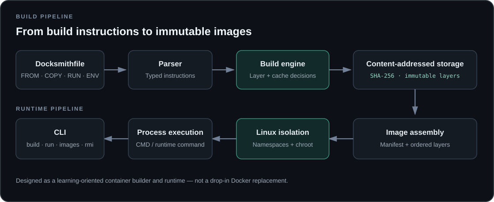

# Docksmith

<div align="center">

  

  [](https://github.com/ShashwatSolanki/dock-smith/actions/workflows/ci.yml)
  <a href="https://shashwatsolanki.github.io/ShashwatSolanki/#work">Portfolio preview &amp; project overview</a>

</div>

A simplified **Docker-like build and container runtime system** built from scratch in Go.

Docksmith is designed to help understand how modern container systems work internally — including **layered images, build caching, and process isolation** — without relying on Docker or any existing container runtime.

---

## What is Docksmith?

Docksmith is a CLI tool that:

* Builds images from a `Docksmithfile`
* Stores filesystem changes as **immutable layers**
* Uses **content-addressing (SHA-256)** for storage
* Implements a **deterministic build cache**
* Runs containers using **OS-level isolation (chroot + process execution)**

---

## Features

* **Image Build System**

  * Supports: `FROM`, `COPY`, `RUN`, `WORKDIR`, `ENV`, `CMD`
  * Each `COPY` and `RUN` creates a new layer

* **Layered Image Storage**

  * Layers stored as tar archives
  * Identified using SHA-256 hashes
  * Reused across builds

* **Deterministic Build Cache**

  * Cache keys based on:

    * previous layer digest
    * instruction
    * environment & working directory
    * file hashes (for COPY)
  * Supports `[CACHE HIT]` / `[CACHE MISS]`

* **Container Runtime**

  * Assembles filesystem from layers
  * Runs processes inside isolated root (chroot)
  * Prevents access to host filesystem

* **CLI Interface**

  * `docksmith build`
  * `docksmith run`
  * `docksmith images`
  * `docksmith rmi`

---

## Project Structure

```
docksmith/
├── main.go
├── cmd/
├── internal/
│   ├── parser/
│   ├── builder/
│   ├── runtime/
│   ├── storage/
│   ├── cache/
│   └── utils/
```

---

## Local Storage Layout

All state is stored locally:

```
~/.docksmith/
├── images/   # image manifests (JSON)
├── layers/   # tar files (content-addressed)
└── cache/    # cache key mappings
```

---

## Usage

### Build an image

```
docksmith build -t myapp:latest .
```

### Run a container

```
docksmith run myapp:latest
```

### Override environment variable

```
docksmith run -e KEY=value myapp:latest
```

### List images

```
docksmith images
```

### Remove an image

```
docksmith rmi myapp:latest
```

---

## Constraints

* No network access during build or run
* No Docker / container runtimes allowed
* All operations work offline
* Layers are immutable and content-addressed
* Same input → identical output (reproducible builds)

---

## Goals

This project demonstrates:

* Deep understanding of **container internals**
* Working knowledge of **Linux process isolation**
* Implementation of **build systems and caching**
* Hands-on experience with **filesystem layering and hashing**


